# Banking System

Final project for the Software Design Patterns course.

- Group: SE-2539
- Team members: Gulim Zhumabay, Aiymay Tleu
## 1. About the project

Banking System is a desktop application where a customer can register, log in, open accounts, move money, take loans and make external payments. All data is saved in CSV files, so it stays after the application is closed.

The project demonstrates six design patterns working together in one application: Factory, Decorator, Strategy, Builder, Observer and Adapter.

## 2. Features

- Registration and login. Passwords are never stored as text. The application stores a random salt and a SHA-256 hash.
- Two account types: Checking and Deposit.
- Top up, withdraw and transfer between accounts of any customers.
- Account options: overdraft (checking accounts only) and SMS notifications.
- Term deposit with 15 percent annual interest, paid every month. Money is locked until the term ends.
- Loans: 12 percent rate, 10 percent with a guarantor, optional insurance that adds 2 percent of the amount to the debt. Monthly payments are collected automatically.
- External payments through Visa or SWIFT.
- Account statement with the full history of operations.
- Notifications page: operation reports, fraud alerts, SMS, overdraft, interest and loan messages.
- Next month button that simulates the end of a month (deposit interest and loan payments).

## 3. Design patterns

| Pattern | Student | What it does in the project | Main classes |
|---|---------|---|---|
| Factory | Gulim   | Creates accounts by type name and restores them from the file | AccountFactory, DecoratorFactory |
| Decorator | Gulim   | Adds overdraft and SMS to an account without changing the account class | AccountDecorator, OverdraftDecorator, SmsDecorator |
| Strategy | Guim    | Calculates interest with interchangeable formulas | InterestStrategy, DepositInterest, LoanInterest |
| Builder | Aiymay  | Assembles a loan agreement step by step | LoanAgreementBuilder, LoanAgreement |
| Observer | Aiymay  | Every account notifies its subscribers about each operation | TransactionObserver, FraudDetector, CustomerNotifier, TransactionLogger, AccountSaver |
| Adapter | Aiymay  | Gives Visa and SWIFT one common interface | PaymentGateway, VisaAdapter, SwiftAdapter |

Each student implemented three patterns on their own. The patterns also work together:

- The factory attaches the interest strategy to every new deposit.
- The loan builder sets the rate that the loan interest strategy uses.
- Every operation, including transfers and payments through adapters, is seen by the observers.
- A decorator wraps an account but still sends events to the same observers.

## 4. How the patterns work in the application

Factory. The client passes a type name such as "checking" or "deposit" and receives an Account. The client never calls new on a concrete account class.

Decorator. The Overdraft and SMS buttons wrap the selected account into a decorator. A decorator is an Account and also holds an Account, so options can be stacked. Options are saved as a short code in accounts.csv, and DecoratorFactory rebuilds the chain on start.

Strategy. A deposit account delegates interest calculation to its InterestStrategy. A loan creates a LoanInterest with the rate from its agreement. The formula can be replaced without changing the account.

Builder. LoanService builds an agreement with required fields in the constructor and optional fields (rate, guarantor, insurance) by chained calls. The result is an immutable object. The loan file reader uses the same builder.

Observer. AbstractAccount keeps a list of observers and notifies them after each successful operation. The bank subscribes four observers to every account: operation history, account saving, customer notification and fraud detection (amounts above 10,000).

Adapter. VisaApi and SwiftApi have different methods and parameters. VisaAdapter and SwiftAdapter translate the common pay call into these foreign APIs. ExternalPaymentService works only with PaymentGateway, so a new payment system can be added without changing the service.

## 5. UML diagrams

One diagram per pattern is stored in the images folder.

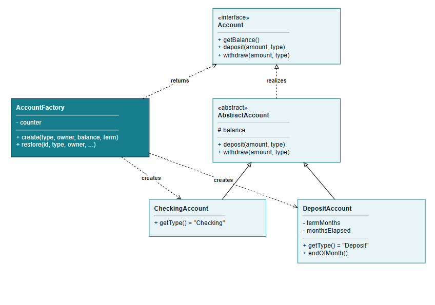

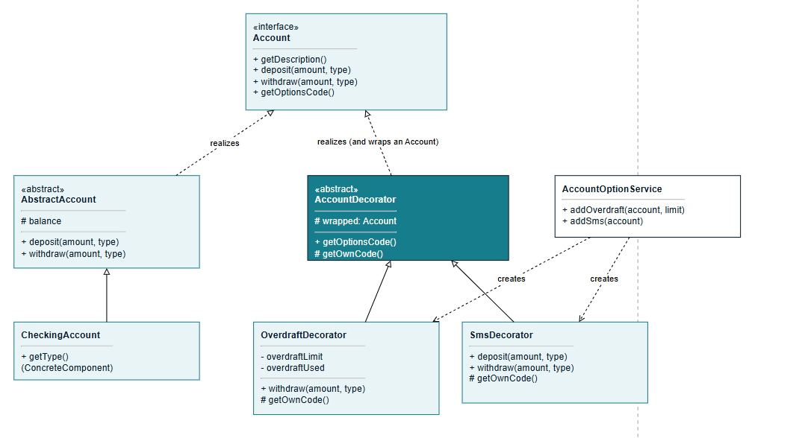

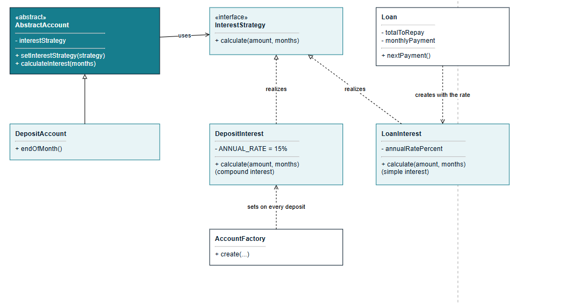

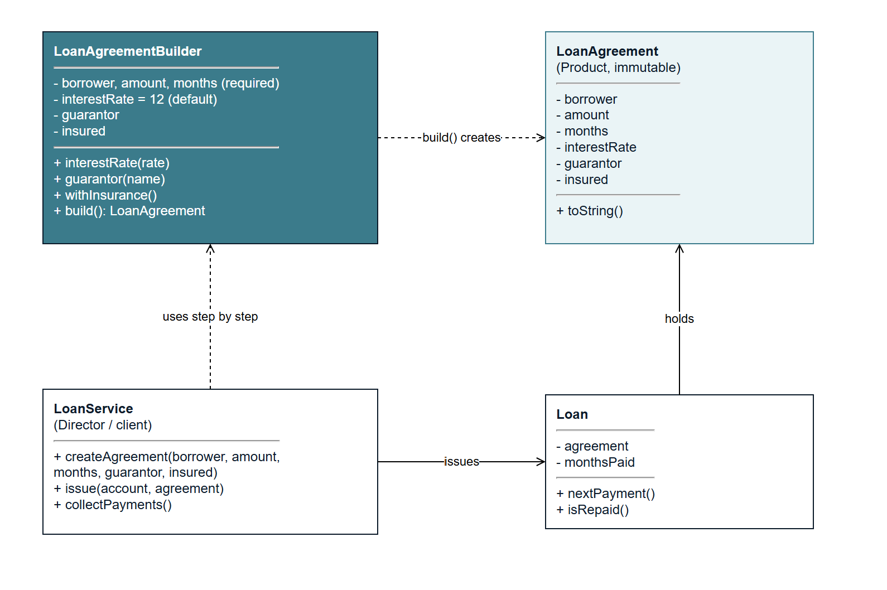

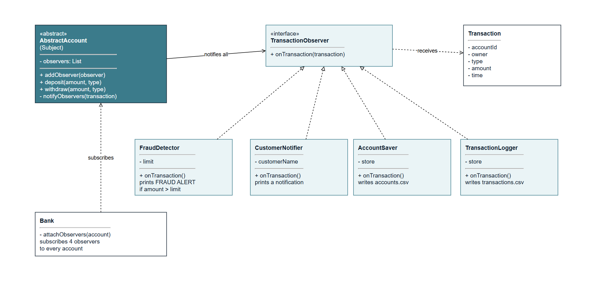

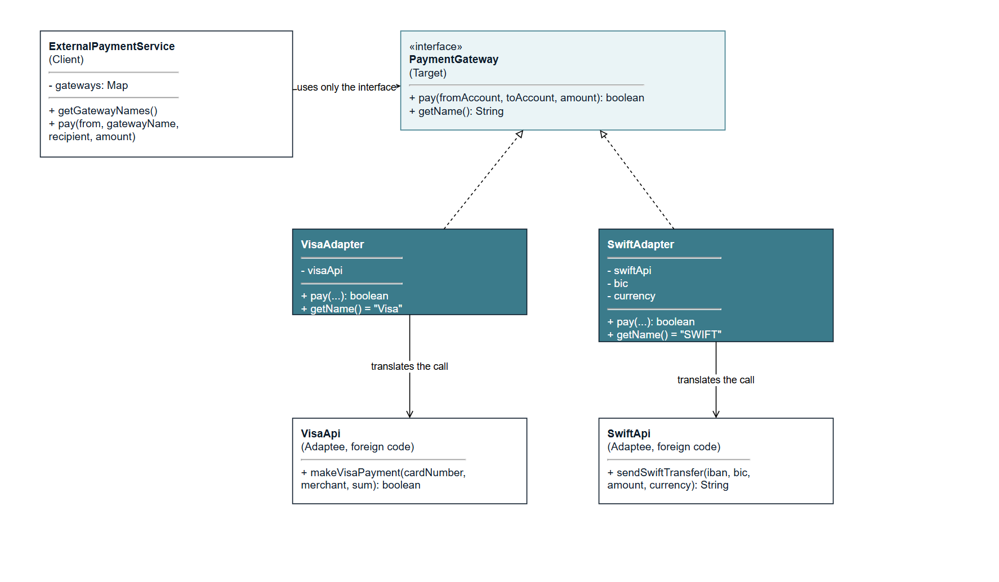


## 6. Screenshots

Screenshots of the application are stored in docs/screenshots.

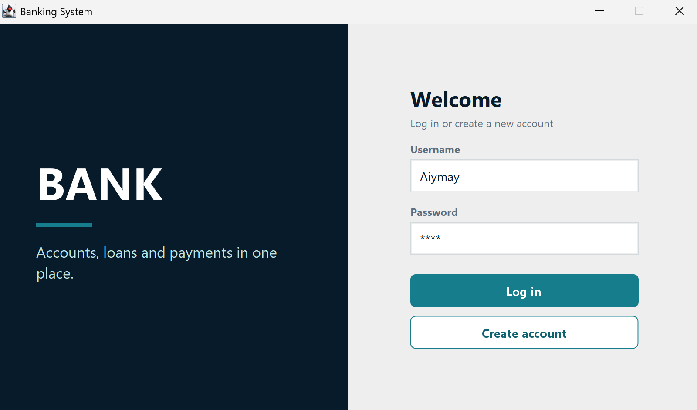

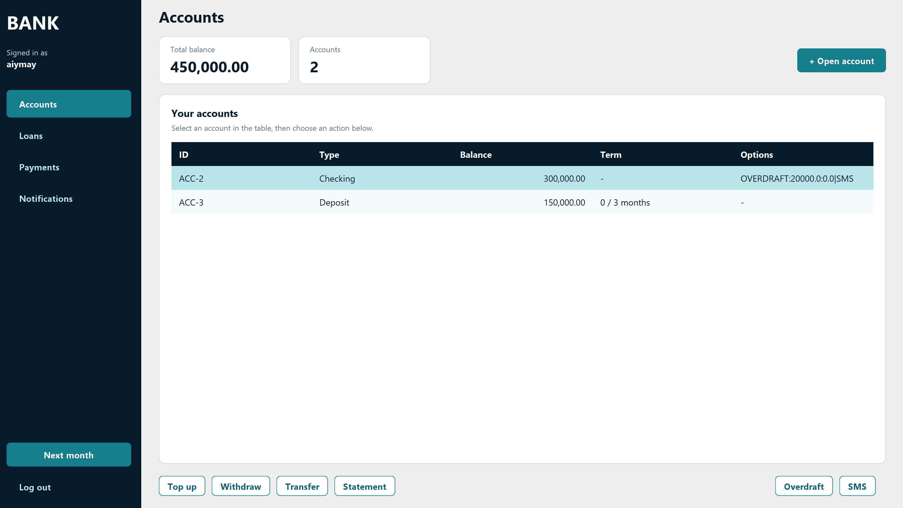

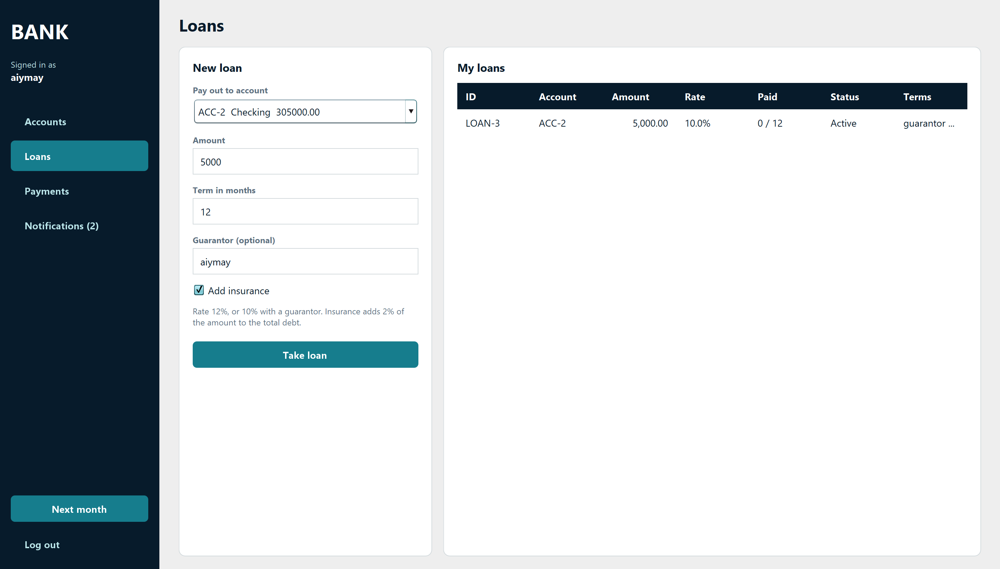

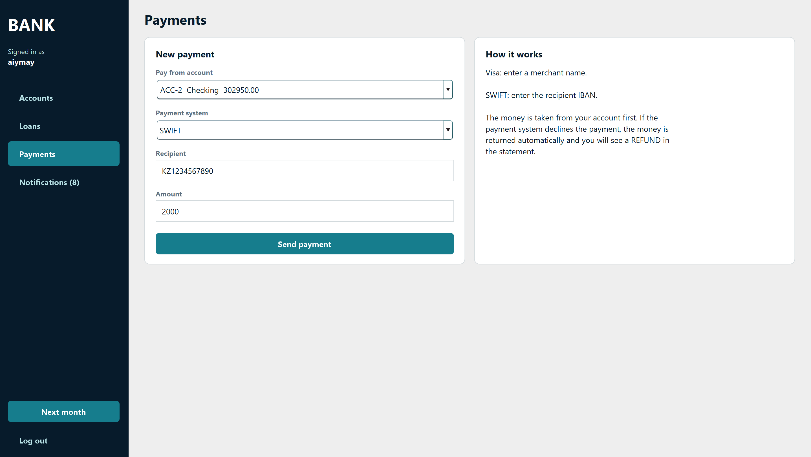

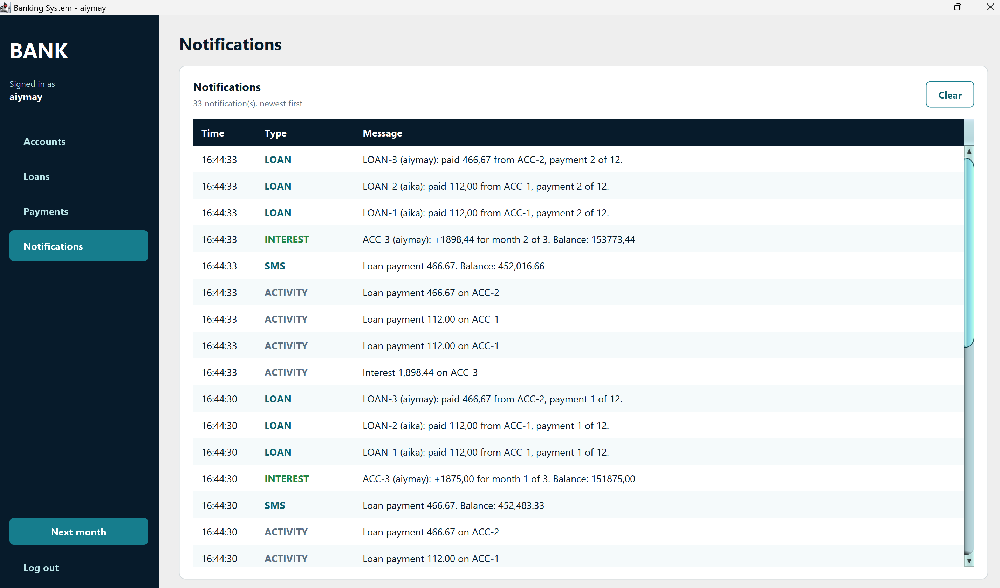

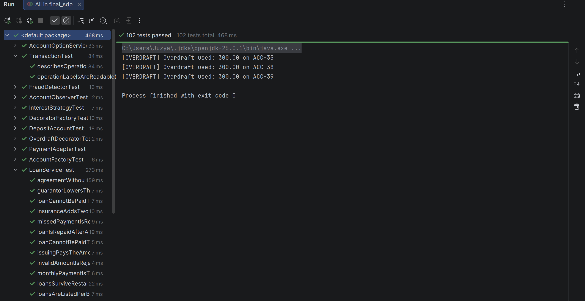

## 7. Project structure

```
src
  account       accounts, transactions, transaction types
  app           bank, console input and console menus
  customer      customer
  decorator     decorators and decorator factory
  factory       account factory
  gui           Swing windows, panels and theme
  loan          loan, agreement and builder
  observer      observers
  payment       payment gateway, adapters, foreign APIs
  security      password hashing
  service       transfers, loans, payments, login, account options
  storage       CSV stores
  strategy      interest strategies
  Main.java     entry point
test            unit tests
data            CSV files
images            UML diagrams and screenshots
```

## 8. Data files

The data folder is created at the first run and is not stored in Git.

| File | Content |
|---|---|
| customers.csv | Username, salt and password hash |
| accounts.csv | Accounts with balance, deposit term and options |
| transactions.csv | History of all operations |
| loans.csv | Loans with the number of paid months |

If the file format changes between versions, delete the data folder once.

## 9. How to run

Requirements: JDK 21 or newer and IntelliJ IDEA.

1. Clone the repository.
2. Open the project in IntelliJ IDEA.
3. Mark the test folder as Test Sources Root.
4. Run the main method in the Main class.
5. Register a new customer and log in.

A quick scenario to see all patterns:

1. Open a checking account with a balance of 1000, and a deposit account for 3 months.
2. Select the checking account and add Overdraft, then SMS.
3. Top up the checking account with 20000 and open the Notifications page (Observer, Decorator).
4. Withdraw more than the balance (Decorator).
5. Open the Loans page, take a loan with a guarantor and insurance (Builder, Strategy).
6. Open the Payments page and pay through Visa and then through SWIFT (Adapter).
7. Press Next month three times and watch the deposit interest (Strategy).

## 10. Tests

The project has 102 unit tests written with JUnit 5. They cover factories, decorators, strategies, the builder, observers, adapters, deposit rules, transfers, loans and external payments.

To run them, right-click the test folder in IntelliJ IDEA and choose Run All Tests.

## 11. Conclusion

In this project we built a desktop banking application that uses six design patterns: Factory, Decorator, Strategy, Builder, Observer and Adapter. Each of us implemented three patterns, which is more than the required minimum of two per student. All six patterns work in the running application and are connected to each other. For example, the factory attaches an interest strategy to every deposit, the loan builder sets the rate for the loan interest strategy, and the observers receive every operation, including payments made through adapters.

The patterns made the code easier to extend. A new account type is added in the factory only. Overdraft and SMS can be combined without writing a class for every combination. A new payment system needs only a new adapter. New observers can be added without changing the account class.

The application saves its data in CSV files and is covered by more than 100 unit tests. We also learned that business rules are better kept in services than in windows: this let us replace the console menu with a graphical interface without rewriting the logic.

The project is a learning model and not a real bank. Its limitations and our ideas for improvement are described in the next section.
## 12. Known limitations and further work

- Next month only simulates time. Real dates are not used.
- Loan interest is calculated once on the whole amount. Banks usually use an annuity schedule.
- There is no penalty for a missed loan payment.
- A withdrawal fully covered by overdraft is not written to the statement.
- Passwords use SHA-256 with a salt. A slow algorithm such as bcrypt would be safer.
- CSV files can be replaced by a database.
- Possible new features: more account types, currency exchange, a user role for bank staff.
